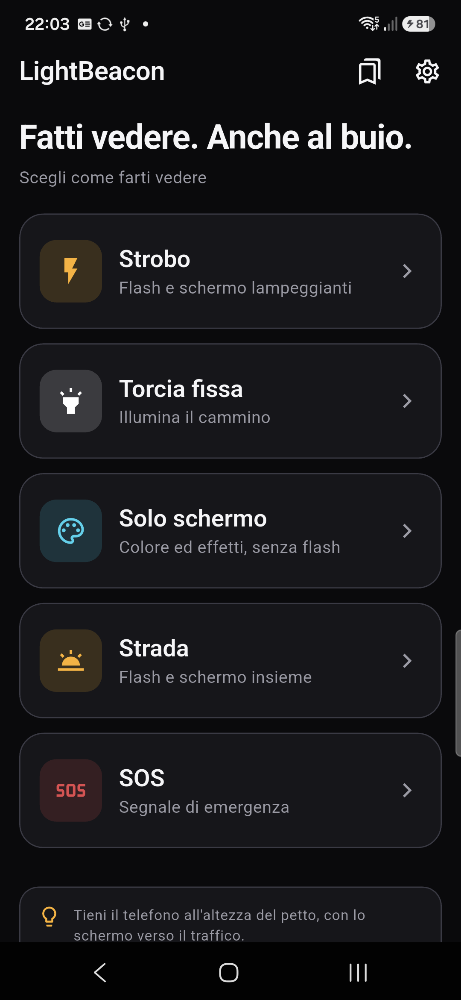
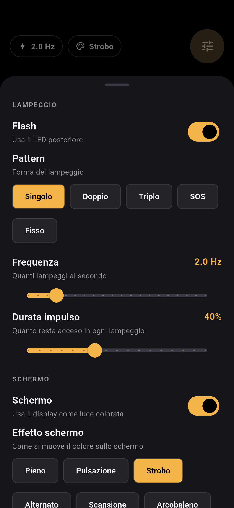
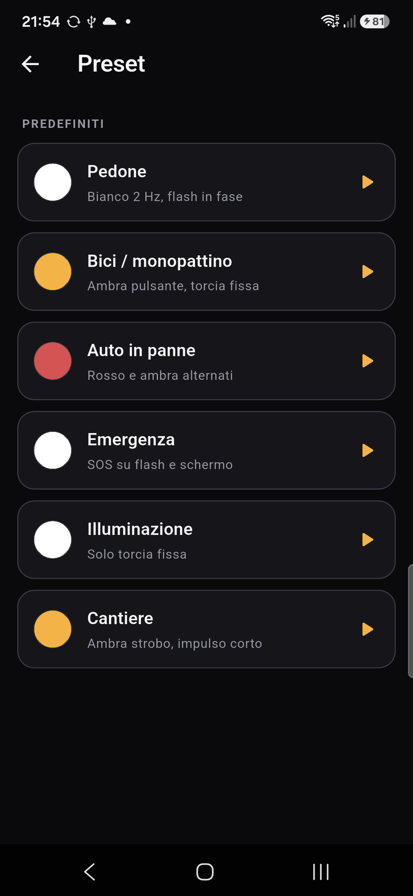
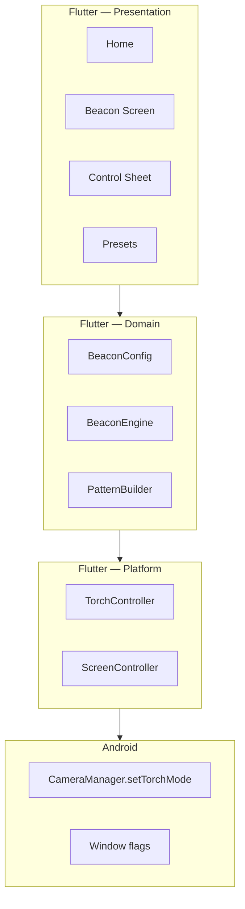

# LightBeacon

**Fatti vedere. Anche al buio.**

App Android che trasforma il telefono in un segnale di visibilità: lampeggio del
flash regolabile, schermo colorato con effetti, torcia fissa per illuminare il
cammino. Pensata per pedoni, ciclisti e automobilisti nei punti delicati della
strada.

<p align="center">
  
  
  
</p>

---

## Funzionalità

### Modalità

| Modalità | Cosa fa |
|---|---|
| **Strobo** | Flash e schermo lampeggianti, frequenza e pattern regolabili |
| **Torcia fissa** | LED sempre acceso per illuminare il cammino |
| **Solo schermo** | Colore ed effetti sul display, senza consumare il flash |
| **Strada** | Flash e schermo insieme, pensato per il traffico |
| **SOS** | Sequenza Morse `··· ——— ···` su flash e schermo |

### Controlli

- **Frequenza** 0.5 – 10 Hz
- **Durata impulso** (duty cycle) 10 – 90%
- **Pattern**: singolo, doppio, triplo, SOS, fisso
- **Effetti schermo**: pieno, pulsazione, strobo, alternato, scansione, arcobaleno
- **Colori**: bianco, ambra, rosso, verde, ciano, magenta
- **Luminosità** schermo con limite di sicurezza configurabile
- **Sincronia** flash/schermo: in fase, controfase, indipendente
- **Spegnimento automatico**: mai, 5, 15, 30, 60 minuti

Il pannello controlli è **contestuale**: mostra solo le regolazioni che hanno
effetto nella configurazione corrente, con una nota esplicativa quando un
controllo non si applica.

### Preset

6 preset predefiniti (Pedone, Bici/monopattino, Auto in panne, Emergenza,
Illuminazione, Cantiere) più preset personalizzati salvabili dal pannello
controlli con un tocco.

### Altro

- Interfaccia **italiano + inglese**, con rilevamento automatico della lingua di
  sistema e override manuale
- Onboarding di sicurezza al primo avvio
- Solo orientamento **portrait** (il telefono sta dritto anche su manubrio)
- Tema scuro, target touch ≥ 56 dp pensati per l'uso con guanti

---

## Sicurezza

> ⚠️ **Il lampeggio rapido può causare crisi epilettiche in persone
> fotosensibili.** Non puntare mai il flash o lo schermo verso gli occhi.

- Default a 2 Hz; avviso esplicito oltre 3 Hz; limite massimo 10 Hz
- **Nessun colore blu**: il lampeggio blu è riservato ai veicoli di emergenza e
  imitarlo è illegale e pericoloso
- LightBeacon **non è un dispositivo di segnalazione omologato**: non sostituisce
  giubbotto riflettente, luci di posizione o segnaletica
- Flash e schermo al massimo consumano molta batteria e scaldano il dispositivo

---

## Requisiti

| Componente | Versione |
|---|---|
| Flutter | 3.41.x (Dart 3.11) |
| Android | 7.0+ (`minSdk` 24) |
| JDK | 17 |

> **Nota sulle dipendenze**: `torch_light` e `wakelock_plus` sono **pinnati** a
> versioni precedenti l'ultima perché le release più recenti richiedono Flutter
> ≥ 3.44. Vedi [docs/PLAN.md](docs/PLAN.md).

---

## Build e installazione

```bash
flutter pub get
flutter gen-l10n          # genera le traduzioni da lib/l10n/*.arb
flutter run               # su device collegato
```

APK di debug:

```bash
flutter build apk --debug
adb install -r build/app/outputs/flutter-apk/app-debug.apk
```

APK di release (richiede configurazione della firma):

```bash
flutter build apk --release --split-per-abi
```

> Il flash e la luminosità **non funzionano su emulatore**: i test vanno fatti su
> dispositivo fisico.

---

## Test

```bash
flutter test              # 76 test: engine, modelli, widget
flutter analyze           # deve essere pulito
```

| Area | Cosa viene verificato |
|---|---|
| `test/engine/` | Matematica dei pattern, fase, compensazione del drift, jitter monitor |
| `test/domain/` | Serializzazione config, migrazioni, preset predefiniti |
| `test/widget/` | Onboarding, home, schermata beacon, pannello controlli, salvataggio preset |

---

## Architettura



### Il motore di lampeggio

Il cuore dell'app sono **due clock separati**:

- **Render clock** — un `Ticker` Flutter che ricalcola la fase a ogni frame e
  disegna lo schermo. Non comanda mai la torcia.
- **Edge clock** — pianifica i fronti on/off della torcia su un'origine assoluta
  (`start + n * ciclo + offset`), mai con `sleep(period)` cumulativo, così il
  jitter non si somma.

I pattern sono espressi in **frazioni di ciclo**, non in millisecondi: cambiare
la frequenza riscala tutto coerentemente.

Un `JitterMonitor` misura lo scarto reale tra fronte pianificato ed effettivo e
segnala quando la piattaforma non riesce a stare dietro alla frequenza richiesta.

Dettagli completi in [docs/PLAN.md](docs/PLAN.md).

---

## Struttura del progetto

```
lib/
  core/          clock monotono, tema
  domain/
    engine/      BeaconEngine, PatternBuilder, PhaseCalculator, JitterMonitor
    models/      BeaconConfig, AppSettings, Preset
    repositories/ persistenza, preset predefiniti
  platform/      TorchController, ScreenController (seam per il nativo)
  features/      home, beacon, presets, settings, onboarding
  providers/     stato Riverpod
  l10n/          ARB italiano/inglese
test/
  engine/  domain/  widget/
android/app/src/main/res/
  mipmap-anydpi-v26/  adaptive icon
  values-v31/         splash Android 12+
  drawable-*/         logo splash
docs/
  PLAN.md             piano tecnico e roadmap
  screenshots/        screenshot per il README
tools/
  generate_icons.py   rigenera icona e splash
```

---

## Stato del progetto

**MVP funzionante e verificato su dispositivo fisico** (Samsung SM-A556B).

Implementato:

- [x] Motore di lampeggio con compensazione del drift
- [x] Torcia, schermo, effetti, colori, sincronia
- [x] Preset predefiniti e personalizzati
- [x] Internazionalizzazione IT/EN
- [x] Onboarding di sicurezza
- [x] Pannello controlli contestuale
- [x] Icona adattiva e splash screen a tema scuro

Da fare (vedi roadmap in [docs/PLAN.md](docs/PLAN.md)):

- [ ] Foreground service per funzionamento a schermo spento
- [ ] Plugin Kotlin custom per strobo preciso oltre ~4 Hz
- [ ] Guardiano batteria/termico
- [ ] Firma release e pubblicazione su Play Store

---

## Licenza

Da definire.
