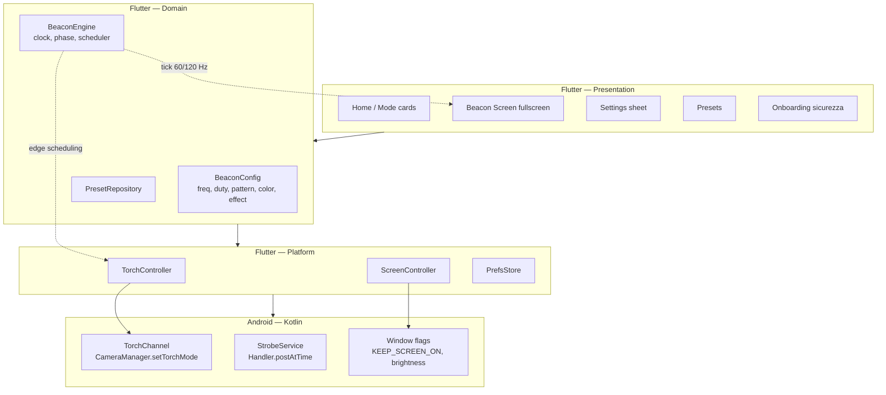

# LightBeacon — Piano tecnico

> App Android (Flutter) che trasforma il telefono in un segnale di visibilità:
> lampeggio del flash regolabile, schermo colorato con effetti, torcia fissa per
> illuminare il cammino. Pensata per essere notati da pedoni e veicoli nei punti
> delicati della strada.

- **Stato**: MVP implementato e verificato su dispositivo fisico
- **Piattaforma**: Android (Flutter 3.41.2 / Dart 3.11.0)
- **Orientamento**: solo portrait (il telefono sta dritto anche su bici/monopattino)
- **Lingue**: Italiano + Inglese
- **Test**: 88 verdi, `flutter analyze` pulito

---

## 1. Visione

Tre output fisici, combinabili:

| Output | Hardware | Controllo |
|---|---|---|
| **Torcia** | LED flash posteriore | on/off, lampeggio, pattern |
| **Schermo** | display OLED/LCD | colore, luminosità, effetti, lampeggio sincronizzato |
| **Audio** (fase 2) | speaker | beep di accompagnamento |

---

## 2. Vincoli tecnici che guidano il design

| Vincolo | Conseguenza |
|---|---|
| Il LED torcia non si accende/spegne in modo affidabile oltre ~5–10 Hz | Lampeggio limitato e **misurato**, non assunto |
| Ogni toggle via MethodChannel costa ~0.1–1 ms + jitter dello scheduler Dart | Sopra ~4 Hz il lampeggio andrebbe spostato in Kotlin (fase 4) |
| `Timer.periodic` in Dart **deriva** | Serve un clock monotono con compensazione del drift |
| Android 14+ richiede `foregroundServiceType` per i servizi in foreground | `specialUse` + dichiarazione, impatto sulla review Play Store |
| Display a luminosità massima + LED = ~2–3 W → thermal throttling in 5–15 min | Cap di luminosità e guardiano termico/batteria |
| Lo schermo è direzionale (~120° orizzontale) | Va gestito nel UX: orientamento, altezza, "facing traffic" |
| Il flash blu lampeggiante è riservato ai veicoli di emergenza (CdS) | Palette di default: bianco/ambra/rosso, blu escluso |

---

## 3. Architettura



**Perché Flutter + Kotlin e non solo Flutter:** Flutter è ottimo per UI, i18n,
effetti schermo e iterazione rapida. Ma il lampeggio preciso e il funzionamento a
schermo spento richiedono un servizio nativo. L'ibrido dà il meglio dei due: UI
in Dart, timing critico in Kotlin.

**Perché non solo nativo:** perderemmo velocità di iterazione su UI/effetti/
localizzazione, che è il 70% del lavoro percepito.

---

## 4. Il cuore: motore di lampeggio

### 4.1 Due clock separati

| Clock | Consumatore | Frequenza | Tecnologia |
|---|---|---|---|
| **Render clock** | schermo (effetti, fade, pulse) | 60/120 Hz | `Ticker` Flutter, phase-based |
| **Edge clock** | torcia (on/off) | 0.5–10 Hz | `Timer` con compensazione drift su clock monotono |

Il render clock **non** comanda la torcia: calcola la fase e disegna. L'edge clock
pianifica i fronti.

### 4.2 Anti-drift

```
start = clock.now
n = 0
loop:
    n += 1
    target = start + n * period
    delay  = target - clock.now
    if delay < 0:            # in ritardo: salta, non accumulare
        n = ceil((clock.now - start) / period)
        continue
    schedule(delay, toggleTorch)
```

Regola d'oro: **mai** `sleep(period)` cumulativo. Si pianifica sempre su
un'origine assoluta, così il jitter non si somma.

### 4.3 Pattern

Un pattern è una lista di segmenti `(peso, stato)` in unità di fase, non in
millisecondi assoluti — così cambiare la frequenza scala tutto coerentemente.
Il *duty cycle* scala i pesi dei segmenti accesi per ottenere il rapporto
on/off richiesto.

| Pattern | Descrizione | Uso |
|---|---|---|
| `single` | 1 impulso per ciclo | default pedone |
| `double` | 2 impulsi ravvicinati | più riconoscibile |
| `triple` | 3 impulsi | alta visibilità |
| `sos` | ··· ——— ··· | emergenza (periodo fisso 7 s) |
| `breathe` | rampa sinusoidale | modalità "calma", no strobo |
| `steady` | sempre acceso | torcia fissa / illuminare |

### 4.4 Sincronizzazione schermo ↔ torcia

- **In fase** — schermo e torcia si accendono insieme (massima resa)
- **In controfase** — alternati (percepito come più continuo, meno fastidioso)
- **Indipendente** — schermo con effetto continuo, torcia a impulsi

### 4.5 Guardiani automatici

- **Jitter monitor**: misura lo scarto reale tra fronte pianificato ed effettivo.
  Se la mediana supera la soglia, riduce la frequenza e mostra un avviso.
- **Thermal/battery guard** (fase 5): batteria bassa o temperatura elevata →
  riduce luminosità e duty cycle.
- **Duty cycle cap**: default 50%, max 90%.

---

## 5. Specifica funzionale

### 5.1 Modalità

| Modalità | Cosa fa | Note |
|---|---|---|
| **Torcia fissa** | LED sempre acceso | illuminare il cammino; timeout configurabile |
| **Strobo** | LED + schermo lampeggianti | freq, duty, pattern regolabili |
| **Schermo** | solo display, colore + effetto | risparmia batteria, nessun LED |
| **SOS** | pattern SOS su LED + schermo | tasto rapido, non modificabile |
| **Combo** | LED + schermo | preset "strada" |

### 5.2 Controlli regolabili

- **Frequenza**: 0.5 – 10 Hz (slider logaritmico, default 2 Hz)
- **Duty cycle**: 10 – 90% (default 50%)
- **Pattern**: single / double / triple / sos / breathe / steady
- **Colore schermo**: bianco, ambra, rosso, verde, ciano, magenta + tinta libera
- **Effetto schermo**: solid, pulse, strobe, alternate, sweep, rainbow
  (strobe e alternate richiedono un pattern lampeggiante: con `steady` non
  hanno un ciclo da seguire e non vengono offerti)
- **Luminosità schermo**: 10 – 100% (con cap di sicurezza)
- **Sincronia**: in fase / controfase / indipendente
- **Timeout**: nessuno / 5 / 15 / 30 / 60 min

### 5.3 Preset

| Preset | Config |
|---|---|
| **Pedone** | schermo bianco 2 Hz, torcia in fase, duty 40% |
| **Bici / monopattino** | ambra pulse 1.5 Hz, torcia steady |
| **Auto in panne** | rosso/ambra alternate 1 Hz, torcia triple |
| **Emergenza** | SOS, schermo bianco max |
| **Illuminazione** | torcia steady, schermo spento |
| **Cantiere** | ambra strobe 1 Hz, duty 30% |

### 5.4 UX (portrait, uso a mano)

- **Home**: card grandi, una per modalità, tap = avvio immediato.
- **Beacon screen**: fullscreen immersivo, system UI nascosta, sfondo =
  colore/effetto. Tap = mostra/nascondi HUD. Pulsante stop sempre raggiungibile.
- **Pannello controlli**: bottom sheet con slider grandi, pensato per il pollice,
  target ≥ 56 dp.
- **Onboarding** al primo avvio: avviso fotosensibilità + disclaimer + lingua.

---

## 6. Modello dati

| Entità | Campi |
|---|---|
| `BeaconConfig` | `mode`, `frequencyHz`, `dutyCycle`, `pattern`, `primaryColor`, `secondaryColor`, `effect`, `brightness`, `sync`, `timeoutMinutes`, `torchEnabled`, `screenEnabled` |
| `Preset` | `id`, `nameKey` (i18n) o `customName`, `config`, `isBuiltIn` |
| `AppSettings` | `localeCode`, `safetyAcknowledged`, `maxFrequencyHz`, `brightnessCap`, `keepAwake` |

Persistenza: `shared_preferences` con JSON versionato (`schemaVersion` per
migrazioni future).

---

## 7. Stack e versioni

⚠️ Le ultime release di alcuni plugin richiedono Flutter ≥ 3.44, che **non** è
disponibile. Vanno pinnate:

| Pacchetto | Versione | Motivo del pin |
|---|---|---|
| `torch_light` | **1.1.0** | 2.0.0 richiede Flutter 3.44 |
| `wakelock_plus` | **1.7.0** | 1.8.x richiede Flutter 3.44 |
| `flutter_foreground_task` | **10.0.0** | 11.x richiede Flutter 3.44 (fase 4) |
| `flutter_riverpod` | **3.3.2** | 3.4.x richiede Dart 3.12 |
| `screen_brightness` | 2.1.11 | ok |
| `shared_preferences` | 2.5.6 | ok |
| `flutter_localizations` + `intl` | SDK | i18n IT/EN |

**Nota su `torch_light`**: per l'MVP va bene (on/off via MethodChannel). Per lo
strobo preciso (>4 Hz) e a schermo spento serve un **plugin Kotlin custom** che
espone `startStrobe(periodMs, duty, pattern)` e usa `CameraManager.setTorchMode`
direttamente. L'interfaccia `TorchController` fa da seam per la sostituzione.

---

## 8. Struttura del progetto

```
lib/
  main.dart
  app.dart
  l10n/            app_it.arb, app_en.arb, generated/
  core/
    theme/         colori, tipografia, dark-only
    clock/         MonotonicClock
  domain/
    models/        beacon_config.dart, preset.dart, app_settings.dart
    engine/        beacon_engine.dart, pattern.dart, phase.dart, jitter_monitor.dart
    repositories/  preset_repository.dart, settings_repository.dart
  platform/
    torch/         torch_controller.dart
    screen/        screen_controller.dart
  features/
    home/          home_page.dart, mode_card.dart
    beacon/        beacon_page.dart, control_sheet.dart, effect_painter.dart
    presets/       presets_page.dart
    onboarding/    safety_page.dart
    settings/      settings_page.dart
  providers/       providers.dart
android/app/src/main/kotlin/.../
  MainActivity.kt
test/
  engine/          pattern_test.dart, phase_test.dart, edge_test.dart
  domain/          config_serialization_test.dart
```

---

## 9. Android: manifest e permessi

| Elemento | Valore |
|---|---|
| `minSdk` | 24 |
| `targetSdk` | 36 |
| Permessi (MVP) | `WAKE_LOCK` |
| Permessi (fase 4) | `FOREGROUND_SERVICE`, `FOREGROUND_SERVICE_SPECIAL_USE`, `POST_NOTIFICATIONS` |
| **Non** serve | `CAMERA` (`setTorchMode` non la richiede) |
| Activity | `screenOrientation="portrait"` |

**Rischio Play Store (fase 4)**: `specialUse` richiede giustificazione in review.
Piano B: funzionamento solo a schermo acceso con `FLAG_KEEP_SCREEN_ON`.

---

## 10. Internazionalizzazione IT + EN

- `flutter_localizations` + ARB (`app_it.arb`, `app_en.arb`), `flutter gen-l10n`.
- Lingua: auto-detect dal sistema, override manuale in Impostazioni.
- Tutte le stringhe con chiavi semantiche.
- Nomi dei preset built-in localizzati; preset utente non tradotti.

---

## 11. Sicurezza, accessibilità, legalità

**Fotosensibilità (obbligatorio)**
- WCAG 2.3.1: max 3 flash/s per contenuti sicuri. L'app *supera* questa soglia per
  definizione → avviso esplicito, non blocco.
- Default 2 Hz. Sopra 3 Hz: warning modale la prima volta. Hard cap 10 Hz.
- Testo: *"Il lampeggio rapido può causare crisi epilettiche in persone
  fotosensibili. Non puntare verso gli occhi."*

**Sicurezza stradale**
- Disclaimer: non è un dispositivo omologato di segnalazione (art. 151/153 CdS).
- **Niente blu lampeggiante**: rischio di essere scambiati per forze dell'ordine.
- Suggerimento UX: tenere a petto/altezza zaino, schermo verso il traffico.

**Accessibilità**
- Contrasto ≥ 4.5:1 sui controlli (su sfondo scuro, non sul colore lampeggiante).
- `Semantics` label su tutti i controlli; supporto TalkBack.
- Rispetto di `MediaQuery.disableAnimations`.
- Target touch ≥ 56 dp (uso con guanti).

**Batteria/termico**
- Cap luminosità configurabile, default 80%.
- Auto-stop a batteria < 10% (fase 5).

---

## 12. Roadmap

| Fase | Contenuto | Stima | Stato |
|---|---|---|---|
| **0 — Setup** | `flutter create`, i18n, tema dark, navigazione | 0.5 g | ✅ |
| **1 — Motore + torcia** | `BeaconEngine`, clock monotono, `TorchController`, pattern, test | 1.5 g | ✅ |
| **2 — Schermo + effetti** | fullscreen, colore, `CustomPainter`, brightness | 1 g | ✅ |
| **3 — Preset + persistenza** | repository, salvataggio config, preset built-in | 0.5 g | ✅ |
| **4 — Foreground service** | Kotlin `StrobeService`, plugin custom, schermo spento | 1.5 g | ⬜ |
| **5 — Sicurezza + onboarding** | avvisi, guardiani, accessibilità, i18n completa | 0.5 g | 🟡 parziale |
| **6 — Test su device + release** | matrice device, tuning jitter, signing, Play Console | 1.5 g | 🟡 parziale |

**Totale: ~7 giorni uomo** per una v1 pubblicabile.

### Stato dettagliato

**Fatto e verificato su device (Samsung SM-A556B):**

- Motore con compensazione del drift, validato misurando i log del driver LED
  (`setTorchModeStrength`): a 2 Hz con duty 40% il flash resta acceso 200 ms e
  spento 300 ms, come da configurazione
- Schermata beacon fullscreen con 6 effetti, 6 colori, luminosità applicativa
- Pannello controlli contestuale: nasconde le regolazioni che non hanno effetto
  e spiega perché
- Preset predefiniti + salvataggio preset personalizzati dal pannello
- i18n IT/EN completa, onboarding di sicurezza
- Icona adattiva (con layer monocromatico per Android 13+) e splash screen a
  tema scuro, generati da `tools/generate_icons.py`
- 88 test (engine, modelli, widget, painter)

**Da fare:**

- Fase 4: foreground service + plugin Kotlin per strobo preciso e schermo spento
- Fase 5: guardiano batteria/termico, riduzione automatica della frequenza basata
  sul `JitterMonitor` (la misura c'è, manca l'applicazione automatica)
- Fase 6: matrice device, firma release, Play Console

### Decisioni prese

- **MVP prima del plugin Kotlin custom**: si parte con `torch_light`, il seam
  `TorchController` permette la sostituzione in fase 4 senza toccare la UI.
- **Solo portrait**: il telefono sta dritto anche montato su bici/monopattino.

---

## 13. Rischi principali

| Rischio | Impatto | Mitigazione |
|---|---|---|
| LED non regge >5 Hz su alcuni device | Alto | Jitter monitor + riduzione automatica + test matrix |
| Thermal throttling del display | Medio | Cap luminosità, duty cycle, avviso |
| Review Play Store su `specialUse` | Medio | Piano B: solo schermo acceso |
| Confusione con lampeggianti di emergenza | Medio-alto | Palette senza blu, disclaimer |
| Fotosensibilità | Alto (legale/etico) | Onboarding, default bassi, cap |
| Schermo direzionale → poca visibilità laterale | Medio | UX: orientamento, suggerimenti d'uso |

---

## 13-bis. Bug trovati durante l'implementazione

Registrati perché sono lezioni utili per le fasi successive.

| Bug | Come è emerso | Correzione |
|---|---|---|
| Offset degli edge scalati su 1 s invece del ciclo | Misurando i log del driver LED sul device: a 2 Hz il flash stava acceso 400 ms invece di 200 | `_cumulativeOffsets` ora scala su `cycle.inMicroseconds` |
| `maybePop()` dentro `PopScope(canPop: false)` | Test widget: il pulsante Ferma non chiudeva mai la schermata | `Navigator.pop()` incondizionato + guardia `_stopping` |
| Ticker che leggeva i provider a ogni frame | Test widget: `ProviderContainer already disposed` uscendo | Engine e clock risolti una volta in `initState` |
| `WakelockPlus` atteso in `stop()` | Test appeso: il canale di piattaforma non risponde nei test | Chiamata fire-and-forget con `catchError` |
| `_pulseSegments` con 1 impulso ignorava il duty | Test unitario: somma dei segmenti = 0.685 invece di 1.0 | Ramo dedicato per `pulses == 1` |
| `TextEditingController` distrutto durante la chiusura del dialog | Test widget: crash `used after being disposed` | Controller spostato in un `StatefulWidget` dedicato |
| Strobo/Alternato congelati su un colore con pattern fisso | Segnalato in uso: in modalità Strada lo schermo restava fermo | `BeaconConfig.effectSupported`/`normalized`: gli effetti guidati dal pattern non sono offerti con `steady` e degradano a `solid` |

**Lezione**: i test unitari non bastano per il timing. La verifica sui log del
driver LED (`adb logcat | grep setTorchModeStrength`) è l'unico modo per sapere
se il flash fa davvero quello che il codice crede.

---

## 14. Strategia di test

- **Unit**: matematica di fase, pattern, compensazione drift, serializzazione
  config, migrazioni schema.
- **Widget**: beacon screen in stato on/off, sheet controlli, cambio lingua.
- **Golden**: rendering degli effetti a fasi note (deterministico, no timing reale).
- **Device manuale**: 5 device (OLED + LCD, fascia alta + bassa), misura jitter
  reale a 1/2/5/10 Hz, test 30 min per surriscaldamento.
- **Strumento interno**: schermata debug con jitter mediano/p95.
